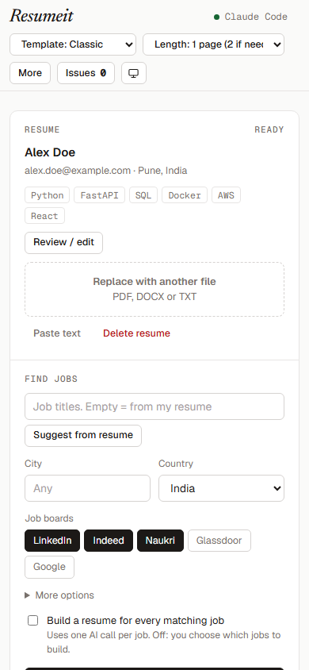
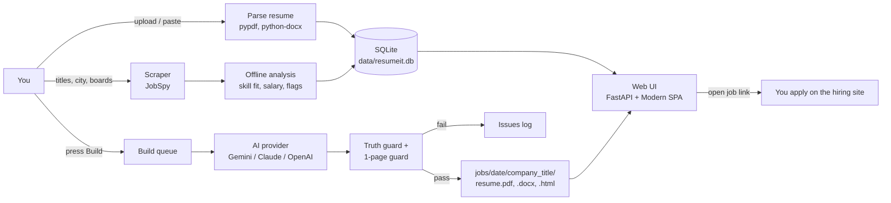

# Resumeit

<p align="center">
  <a href="https://github.com/Lakshyajeet-Singh-Goyal/resumeit/actions"></a>
  
  
  
  
</p>

A local, single-user tool that finds jobs across top boards and generates a **tailored, one-page resume for each job description** based strictly on your own profile. You review the resume, confirm its truthfulness, and apply yourself.


---

## ✨ Features

- **Upload Once**: Upload a resume in PDF, DOCX, TXT, or pasted text. It is automatically parsed into a structured, editable profile.
- **Multi-Board Search**: Search LinkedIn, Indeed, Naukri, Glassdoor, and Google via [JobSpy](https://github.com/speedyapply/JobSpy), or paste a job link/description directly.
- **Zero-AI Skill Matching**: Every job card instantly displays matched skills, salary, work mode, job type, posting age, and flags (night shift, bond, seniority, clearance) *without consuming any AI quota*.
- **Tailored Resumes (7 ATS Templates)**: Choose from Classic, Modern, Compact, Minimal, Executive, Tech, or Elegant templates with instant PDF & DOCX export.
- **Truth Guard**: Algorithmic verification prevents AI hallucinations. Any fabricated skill, title, company, or metric is automatically rejected.
- **Strict 1-Page Guarantee**: Headless browser renders and page-counts each PDF, automatically scaling typography and trimming non-essential lines to maintain an exact 1-page fit (or comfortable 2-page fit if selected).
- **"What Changed" Diff**: Side-by-side diff highlights every reworded bullet, dropped line, and emphasized skill before sending.
- **Resume Chat Customizer**: Fine-tune your tailored resume in natural language (e.g. *"Emphasize cloud architecture"*, *"Shorten summary"*).
- **Application Tracker**: Manual status management (`Not applied`, `Applied`, `Interview`, `Rejected`, `Offer`) to keep search pipelines clean.
- **Modern Responsive UI**: Clean light and dark modes, high-contrast accessible design system, and full mobile optimization.
- **Daily Background Scanner & MCP Server**: Automate daily job sweeps via Task Scheduler and query jobs via Claude Desktop or MCP agents.

| Preview & "What Changed" | Dark Theme | Mobile Responsive |
|:---:|:---:|:---:|
|  |  |  |

---

## 🔒 Non-Negotiable Core Rules

1. **It Never Applies For You**: No forms, emails, or "Easy Apply" automation. You apply on the original hiring site yourself. Status changes are only set manually by you.
2. **Zero Lies (The Truth Guard)**: Only verified facts from your uploaded profile are included. Missing requirements are clearly flagged as skill gaps.
3. **One-Page Fit**: Resumes are dynamically styled and trimmed to fit standard single-page A4 format without awkward whitespace or spillover.

---

## 🛠️ Architecture & Data Flow



### Project Layout

| Path | Description |
|---|---|
| `app/main.py` | FastAPI application, route handlers, queue engine |
| `app/resume.py`, `app/guard.py`, `app/diff.py` | Profile tailoring, truth verification, 1-page fitter, and diff engine |
| `app/scrape.py`, `app/fetch.py`, `app/details.py` | Job search scrapers, URL fetcher, salary & metadata parsers |
| `app/ai.py`, `app/cover.py` | Multi-provider AI adapters, cover letter generator |
| `app/db.py`, `app/export.py` | SQLite database connection, PDF and DOCX export |
| `app/scan.py`, `app/mcp_server.py` | Scheduled daily background scan, MCP server tool interface |
| `static/index.html` | Modern, responsive, human-crafted single-page frontend |
| `tests/` | Comprehensive offline pytest test suite |

---

## 🚀 Quick Setup & Installation

### Prerequisites
- Python 3.12 or newer
- Microsoft Edge or Google Chrome (used for headless PDF generation)

### Windows
```bat
git clone https://github.com/Lakshyajeet-Singh-Goyal/resumeit.git
cd resumeit
python -m venv .venv
.\.venv\Scripts\pip install -r requirements.txt
copy .env.example .env
run.bat
```

### macOS & Linux
```bash
git clone https://github.com/Lakshyajeet-Singh-Goyal/resumeit.git
cd resumeit
python3 -m venv .venv
source .venv/bin/activate
pip install -r requirements.txt
cp .env.example .env
python -m app
```
Open **`http://127.0.0.1:8000`** in your browser.

---

## ⚙️ Configuration (`.env`)

| Variable | Description |
|---|---|
| `GEMINI_API_KEY`, `GEMINI_MODEL` | **Free recommended option.** Get a free API key at [Google AI Studio](https://aistudio.google.com/apikey). |
| `AI_PROVIDER` | `auto` (first configured), `gemini`, `claude_cli`, `anthropic`, `openai`, `opencode` |
| `CLAUDE_BIN`, `CLAUDE_MODEL` | Claude Code CLI path and model (uses existing local CLI auth, no separate API key required). |
| `ANTHROPIC_API_KEY`, `ANTHROPIC_MODEL` | Anthropic Claude API key and model (e.g. `claude-sonnet-5-5`). |
| `OPENAI_API_KEY`, `OPENAI_MODEL` | OpenAI API key and model (e.g. `gpt-4o`). |
| `OPENCODE_BIN`, `OPENCODE_MODEL` | OpenCode CLI (`npm i -g opencode-ai`), free community models. |
| `HOST`, `PORT` | Local server bind address (default `127.0.0.1:8000`). |

---

## 🛡️ Privacy & Zero Data Leak Guarantee

- **100% Local-First**: The server strictly binds to `127.0.0.1` and rejects non-local `Host` headers and foreign `Origin` requests (DNS rebinding and drive-by protection).
- **Strictly Ignored Personal Data**: All applicant resumes, parsed databases (`data/resumeit.db`), logs (`data/issues.log`), and tailored exports (`jobs/`) are protected by comprehensive `.gitignore` rules. No personal information or credentials are ever pushed to GitHub.
- **Direct AI Calls Only**: Your base profile is sent solely to your chosen, configured AI provider to rewrite relevant experience for the selected job posting. Nothing is sent to third-party tracking services.

---

## 🤖 Model Context Protocol (MCP) Server

Resumeit includes a fully featured MCP server for integration with Claude Desktop, Cursor, or AI agents:

```bash
claude mcp add resumeit -- D:\path\to\resumeit\.venv\Scripts\python.exe -m app.mcp_server
```

**Exposed Tools**: `get_profile`, `list_jobs`, `get_job`, `search_jobs`, `estimate_ai_calls`, `build_resume`, `what_changed`, `write_cover_letter`, `run_daily_scan`, `list_issues`. *(Tools to auto-apply or overwrite tracker status are omitted by design).*

---

## 🧪 Testing

```bash
pip install -r requirements-dev.txt
python -m pytest -q
```

All 236 offline tests execute with stubbed AI and mock scrapers to verify guards, scrapers, APIs, exports, and UI contracts.

---

## 📄 License

Distributed under the [MIT License](LICENSE).
