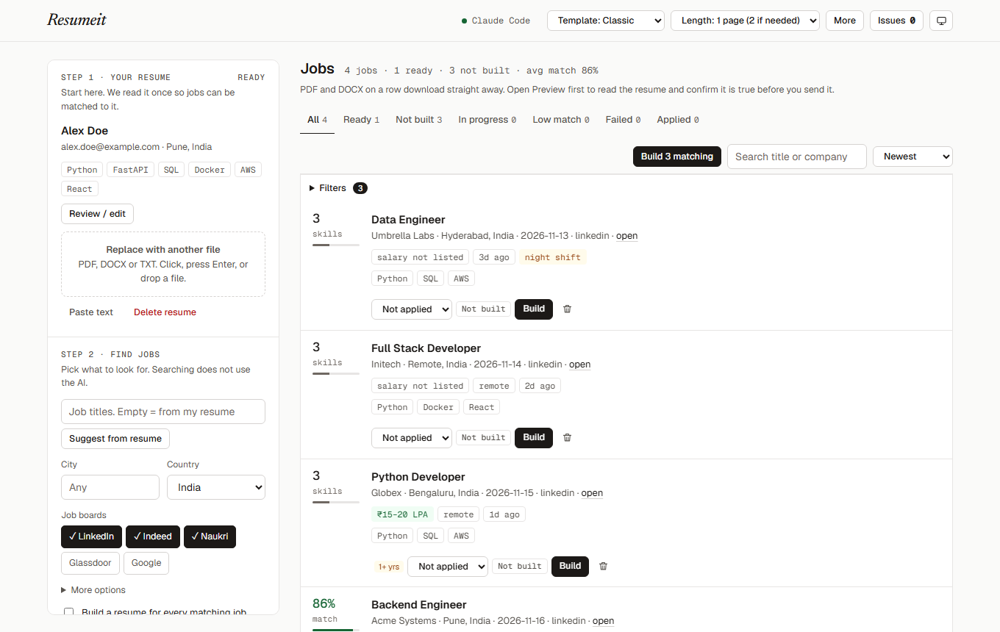
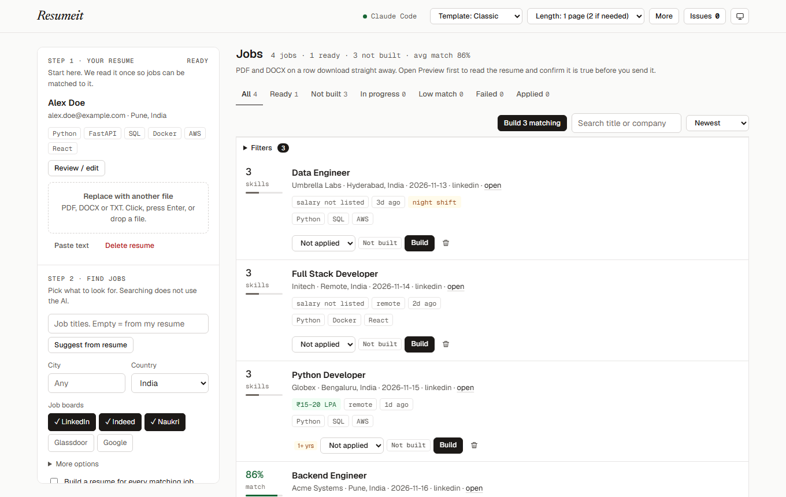
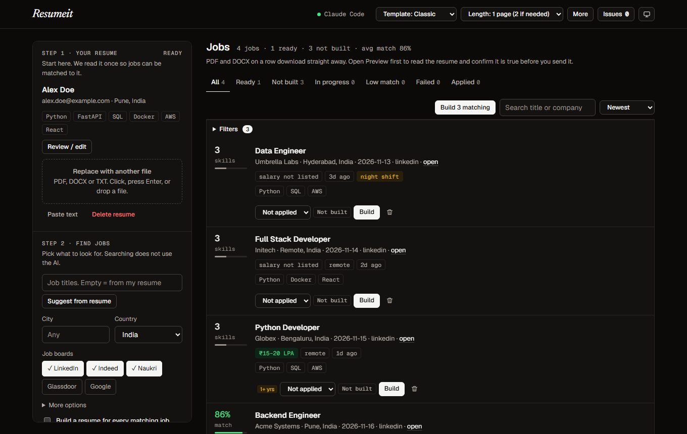
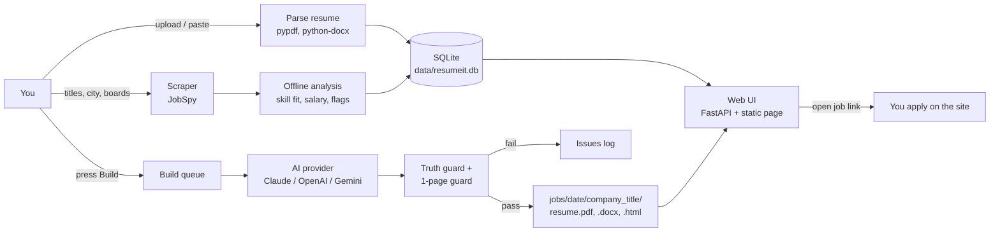

# Resumeit

A local, single-user tool that finds jobs and builds a **tailored, one-page resume for each job description** from your own resume. You review it and apply yourself.



## Features

- Upload a resume once (PDF, DOCX, TXT or pasted text). It is parsed into a structured profile you can edit.
- Search LinkedIn, Indeed, Naukri, Glassdoor and Google with [JobSpy](https://github.com/speedyapply/JobSpy), or add a job from a link or pasted description.
- Every job shows, without any AI call: how many of your skills it mentions, salary, work mode, job type, age, and warnings (night shift, bond, unpaid, seniority, US-only).
- Build a tailored resume per job: 7 templates, PDF and DOCX export, a "What changed" diff against your base resume, optional cover letter.
- Manual tracker (Applied / Interview / Rejected / Offer), daily scan, MCP server, backup.

| Preview and "What changed" | Dark theme | Mobile |
|---|---|---|
|  |  |  |

## Rules the tool follows

1. **It never applies for you.** No forms, emails or "Easy Apply". You press apply on the original site. "Applied" is only ever set by you.
2. **No lies in the resume.** Only facts from your resume are used. Skills you lack show as gaps. A code check (the truth guard) rejects any new skill, company, title, date, degree or number.
3. **One page** (two only if the content really needs it). Every PDF is page-counted and trimmed, never padded.

Full plan: [docs/PLAN.md](docs/PLAN.md).

## How it works



Data flow, step by step:

1. **Parse.** Your file is turned into text, then into a JSON profile (name, skills, experience, projects, education). This is the only source of facts.
2. **Search.** JobSpy fetches postings. For each one the app reads salary, mode, type, age, seniority and location rules from the text. No AI is used.
3. **Build** (only when you press it, or tick auto-build). One AI call rewrites your profile for the job description: reorder, drop, reword. Nothing new may be added.
4. **Guard.** The truth guard compares the result to your profile. A failure rejects the resume and logs the reason in Issues. Then the PDF is rendered with Edge or Chrome and its pages counted; fonts and content are trimmed until it fits.
5. **Review.** Preview, check "What changed", download, apply yourself.

### Project layout

| Path | Role |
|---|---|
| `app/main.py` | FastAPI app, API routes, build queue |
| `app/resume.py`, `app/guard.py`, `app/diff.py` | Tailoring, truth/page guards, diff |
| `app/scrape.py`, `app/fetch.py`, `app/details.py`, `app/flags.py` | Job search, page fetch, salary/mode/flag parsing |
| `app/ai.py`, `app/cover.py` | AI providers, cover letter |
| `app/db.py`, `app/export.py` | SQLite, PDF/DOCX output |
| `app/scan.py`, `app/mcp_server.py` | Daily scan, MCP tools |
| `static/index.html` | The whole UI |
| `tests/` | Offline test suite (fake scrapers and AI) |

## Setup

Needs Python 3.12+ and Edge or Chrome (used to make the PDF).

```
python -m venv .venv
.venv\Scripts\pip install -r requirements.txt
copy .env.example .env
run.bat
```

`run.bat` opens http://127.0.0.1:8000. On Linux/macOS: `python -m app` (PDF needs Chrome or Chromium on the machine).

### Configuration (`.env`)

| Variable | Meaning |
|---|---|
| `GEMINI_API_KEY`, `GEMINI_MODEL` | **Free option.** Get a key at [aistudio.google.com/apikey](https://aistudio.google.com/apikey), no billing needed. |
| `AI_PROVIDER` | `auto` (first available), `claude_cli`, `anthropic`, `openai`, `gemini`, `opencode` |
| `OPENCODE_BIN`, `OPENCODE_MODEL` | [OpenCode](https://opencode.ai) CLI, free models, no key. Model as `provider/model`; empty = its default. |
| `CLAUDE_BIN`, `CLAUDE_MODEL` | Claude Code CLI path / model. No API key needed. |
| `ANTHROPIC_API_KEY`, `ANTHROPIC_MODEL` | Anthropic API |
| `OPENAI_API_KEY`, `OPENAI_MODEL` | OpenAI (untested against the live API) |
| `HOST`, `PORT` | Bind address (default `127.0.0.1:8000`) |

Each resume costs one AI call, so build the jobs you care about instead of everything at once.

## Using it

1. Drop your resume on the left. If a PDF has no readable text, use **Paste text**.
2. **Suggest from resume** for titles, then **Find jobs**.
3. Press **Build** on the jobs you want. Preview opens when ready.
4. Download PDF/DOCX or open the job's folder. Anything skipped or failed is under **Issues** and in `data/issues.log`.

### Daily scan (never applies)

```
PUT /api/saved-search   {"terms":["python developer"],"location":"Pune","max_resumes":5}
scripts\install_daily_task.bat     # Task Scheduler, 09:00 daily
python -m app.scan                 # or run by hand
```

Builds at most `max_resumes` resumes and writes `jobs/_daily.md`. Create `data\STOP` to halt a run.

### MCP server

```
claude mcp add resumeit -- D:\path\to\resumeit\.venv\Scripts\python.exe -m app.mcp_server
```

Tools: `get_profile`, `list_jobs`, `get_job`, `search_jobs`, `estimate_ai_calls`, `build_resume`, `what_changed`, `write_cover_letter`, `run_daily_scan`, `list_issues`. There is deliberately no tool to apply or to set tracker status.

## Privacy and security

- Everything runs on `127.0.0.1`. Resume, jobs and files live in git-ignored `data/` and `jobs/`. Only the text sent to your chosen AI provider leaves your machine (and Google Fonts load on page open).
- Requests with a non-local `Host` or a foreign `Origin` are rejected (DNS rebinding / drive-by pages). There is **no login**: do not expose the port to a network.
- Uploads are capped at 10 MB. `GET /api/health` reports server, database and AI status.

## Development

```
pip install -r requirements-dev.txt
python -m pytest -q          # offline, ~2 min
python scripts/screenshots.py   # optional: needs playwright + chromium
```

CI runs the suite on every push.

## Known limits

- Scraping is fragile: LinkedIn and Naukri block quickly, so some searches return nothing.
- The "open folder" buttons are Windows only.
- The truth guard catches invented facts, not a true fact bent out of shape ("contributed" to "led"). Read each resume before sending.
- DOCX page count cannot be verified; only the PDF is checked.

## License

MIT, see [LICENSE](LICENSE).
